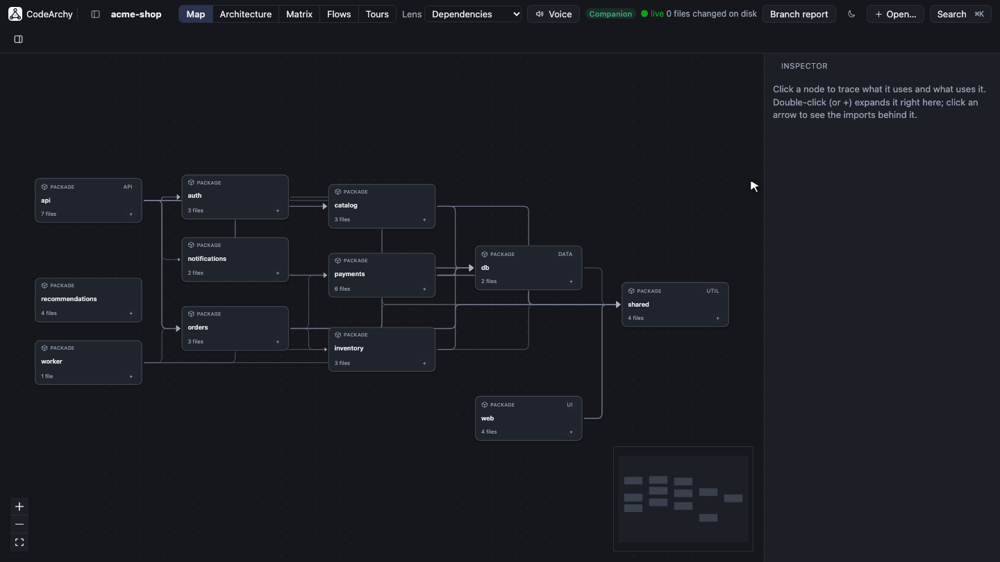

<div align="center">

# CodeArchy

**See how any codebase is built, who owns it, and how much of it AI wrote.**

An architecture map of your code, generated on your machine, in VS Code, in the browser, and for your AI agent.<br>
Free and open source. Private by default.

[](https://marketplace.visualstudio.com/items?itemName=iyinusa.codearchy)
[](https://open-vsx.org/extension/iyinusa/codearchy)
[](https://www.npmjs.com/package/codearchy)
[](LICENSE)



**[Install for VS Code](https://marketplace.visualstudio.com/items?itemName=iyinusa.codearchy)** ·
**[Cursor, Windsurf, VSCodium](https://open-vsx.org/extension/iyinusa/codearchy)** ·
**[Open in the browser](https://app.codearchy.com)** ·
**[`npx codearchy`](https://www.npmjs.com/package/codearchy)**

</div>

---

## Why teams use it

Every codebase has a map in someone's head. CodeArchy draws it from the code, keeps it current, and puts it where everyone can see it.

- **Onboard in days, not weeks.** New engineers start with a generated tour of the system, follow any request from the route to the database, and ask questions whose answers point to the exact files and lines.
- **See your people risk.** The Ownership lens shows who holds each part of the code today, and warns where one person holds most of it, before they go on leave.
- **Know what AI wrote.** The Authorship lens shows how much of each part AI tools wrote, from the evidence they leave in git (`Co-authored-by` trailers, coding-agent commits, tool markers). A branch report puts it in your pull request.
- **Change things safely.** Click any part to see what it uses and what uses it. Health and Tests lenses show cycles, hubs, orphans and untested code.
- **Keep your code private.** Everything is parsed on your machine. AI is optional, and when you use it, you decide what may leave your machine.

## What you get

| | |
|---|---|
| **Map** | The system as packages, components, files and symbols on one canvas. Double-click to expand a part in place; click to see what it uses and what uses it. Navigator, Inspector and ⌘K search. |
| **Lenses** | Colour the Map by **Dependencies**, **Health** (cycles, hubs, orphans), **Tests**, **Authorship** (AI-written lines) or **Ownership** (who last changed the lines still there). |
| **Matrix** | A dependency structure matrix that makes cycles and layering problems obvious. |
| **Flows** | Every entrypoint (HTTP routes, CLI commands, jobs and listeners, UI routes, `main`) and what it does: each call in order, across the parts it passes through, down to the databases, caches, queues and APIs it reaches. |
| **Tours** | **Start Here** is generated for every repository. Write your own tours from the Inspector or a flow and save them to `.codearchy/tours`, so they're reviewed and versioned like code. Narrated, with progress you can resume. |
| **Architecture** | A high-level diagram built from the code: the main parts in layers, their dependencies, callers and external systems. **Design with AI** groups them into named subsystems and services. |
| **Ask** | Questions answered from the map, with citations you can click (to the Map, or to the file and line). Answers can be narrated while the Map follows along, kept as history, followed up, or turned into a tour. |
| **Authorship in the editor** | A gutter beside AI-written and reviewed lines, **Mark Selection as Reviewed**, optional agent session logs (Claude Code, Codex, Aider), git notes to share it with your team, and a **Branch Authorship Report** for pull requests. |
| **In your editor** | A status bar entry and a CodeLens show where the current file sits; **Reveal in Map** from the editor or the Explorer. |
| **Voice** | Tours and answers read aloud by Kokoro, a neural voice that runs on your machine, or by your system's voice. |

Languages: **TypeScript, JavaScript, Python, Java, Kotlin, Go, Rust, C#, PHP and Ruby**, parsed with tree-sitter, with each ecosystem's imports resolved. Flows recognise Express, NestJS, Fastify, Koa, Hono, Next.js, SvelteKit, FastAPI, Flask, Django, Celery, Spring, ASP.NET, gin, net/http, cobra, Laravel, Rails and more.

## Get started

### VS Code (and Cursor, Windsurf, VSCodium)

1. Install **CodeArchy** from the [VS Code Marketplace](https://marketplace.visualstudio.com/items?itemName=iyinusa.codearchy), or from [Open VSX](https://open-vsx.org/extension/iyinusa/codearchy) in editors that use it.
2. Open a project and run **CodeArchy: Show Architecture** (`Cmd+Shift+P` / `Ctrl+Shift+P`), or click the CodeArchy icon in the Activity Bar.
3. Explore the Map. Try the lenses, **Flows** and **Tours**. No AI or setup is needed for any of it.
4. To ask questions, open **AI** in the Map's toolbar and choose a model (see [AI, on your terms](#ai-on-your-terms)).

### In the browser

Open **[app.codearchy.com](https://app.codearchy.com)** and choose a folder, a `.zip`, the sample, or a **public GitHub or GitLab URL**. Everything runs in your browser tab; nothing is uploaded. Share a repository directly with `https://app.codearchy.com/?repo=owner/repo`.

For big repositories, live updates and authorship from git, run the **Companion** in the repository and open the link it prints:

```sh
npx codearchy serve --root .
```

### For your AI agent (MCP)

Give Claude Code, Codex, Gemini CLI or Copilot your architecture map:

```sh
claude mcp add codearchy -- npx -y codearchy mcp --root /path/to/repo
```

The agent gets `overview`, `search`, `get_node`, `neighbors`, `explain_edge`, `find_flows` and `read_code`. See the [MCP guide](docs/guides/mcp.md) for other agents.

The CLI also writes authorship reports for pull requests: `npx codearchy authorship report`. Node.js 22 or later.

## AI, on your terms

The Map, lenses, Flows, Tours and Architecture work without AI. Ask, summary cards and **Design with AI** use the model you choose:

- **On your machine:** Ollama or LM Studio (pick, download and remove Ollama models in AI settings).
- **Your GitHub Copilot plan,** through VS Code's Language Model API.
- **Your own API key:** Anthropic, OpenAI, Google Gemini, OpenRouter, Groq or Mistral. Keys are kept in your OS keychain (VS Code) or encrypted in the browser.

You choose what may leave your machine: **Local only** (the default; nothing leaves), **Structure** (names, signatures, docs and dependencies, no code), or **Structure + code excerpts**. Secrets are removed from anything sent to a cloud model, **Ask before sending** shows each request first, and you can set daily token budgets per provider. Answers are grounded in the map and cite what they rely on.

## How it works

```text
your files ─▶ tree-sitter (10 languages, on your machine) ─▶ symbols, imports, calls
                                                                    │
         git history (blame, commits, notes) ─────────────┐         ▼
                                                          │   dependency graph
                                                          ▼         │
     System ▸ Package ▸ Component ▸ File ▸ Symbol  ◀── hierarchy ───┘
          │
          ├─ lenses: health · tests · authorship · ownership
          ├─ flows: entrypoints traced call by call to databases, queues and APIs
          ├─ tours: Start Here, and yours in .codearchy/tours
          └─ the map, read by your chosen model through tools, with citations
```

The index is persistent and incremental: reopening a workspace reuses what hasn't changed. See [ARCHITECTURE.md](ARCHITECTURE.md) for the engine's design.

## Commands

| Command | What it does |
|---|---|
| `CodeArchy: Show Architecture` | Open the Map |
| `CodeArchy: Analyze Workspace` | Index the workspace again |
| `CodeArchy: Refresh Architecture` | Refresh the current view |
| `CodeArchy: Reveal in Map` | Show the current file on the Map (also in the editor and Explorer context menus) |
| `CodeArchy: Open Sidebar` | Open the CodeArchy view in the Activity Bar |
| `CodeArchy: Branch Authorship Report` | What the current branch adds, and who wrote it, as Markdown for a pull request |
| `CodeArchy: Mark Selection as Reviewed` | Mark AI-written lines as reviewed by you |
| `CodeArchy: Correct Authorship of Selection` | Set who wrote the selected lines |
| `CodeArchy: Write Authorship Notes for the Last Commit` | Record the last commit's AI lines as a git note |
| `CodeArchy: Switch between the Map and the classic views` | Toggle `codearchy.ui` |
| `CodeArchy: Export as SVG` / `Export as PNG` | Export the diagram (classic views) |

## Settings

All of these are also in the Map, under **Settings**, for you or for the workspace.

| Setting | Default | What it does |
|---|---|---|
| `codearchy.includedLanguages` | all ten | Languages to analyse |
| `codearchy.excludePatterns` | `node_modules`, `dist`, `build`… | Glob patterns to skip (files ignored by `.gitignore` are always skipped) |
| `codearchy.maxFileSize` | `500000` | Largest file to analyse, in bytes |
| `codearchy.maxFiles` | `20000` | Most source files to analyse (`0` for no limit) |
| `codearchy.codeLens` | `true` | Show where each file sits in the architecture, at the top of the file |
| `codearchy.ollama.url` | `http://localhost:11434` | Where Ollama listens |
| `codearchy.authorship.enabled` | `true` | The Authorship lens: AI-written code, from git |
| `codearchy.authorship.people` | `true` | The Ownership lens: who owns the code, from git blame (names never go to AI models) |
| `codearchy.authorship.gutter` | `true` | Mark AI-written and reviewed lines beside the code |
| `codearchy.authorship.capture` | `true` | Record AI insertions as they happen in this editor |
| `codearchy.authorship.agentLogs` | `[]` | Read these agents' session logs to see exactly which lines they wrote: `claude-code`, `codex`, `aider` |
| `codearchy.authorship.gitNotes` | `off` | Record authorship in git notes, to share it with your team |
| `codearchy.ui` | `map` | `classic` shows the 1.x System, Flow and Dense views instead |
| `codearchy.aiModel`, `codearchy.aiProcessing` | | Settings for the classic views' AI |

## Contributing

```sh
corepack enable && pnpm install
pnpm build      # every package (Turborepo)
pnpm test       # unit tests
pnpm lint
```

Press **F5** in VS Code to run the extension in a development window. The extension is in `apps/vscode`, the shared engine and UI are in `packages/*`, and the CLI is in `apps/cli`.

Read [CONTRIBUTING.md](CONTRIBUTING.md) to get set up, [ARCHITECTURE.md](ARCHITECTURE.md) for how the engine fits together, and the [language guide](docs/guides/adding-a-language.md) to add a language. Issues and ideas are welcome in [GitHub Issues](https://github.com/CodeArchy/codearchy/issues).

## License

[MIT](LICENSE)
